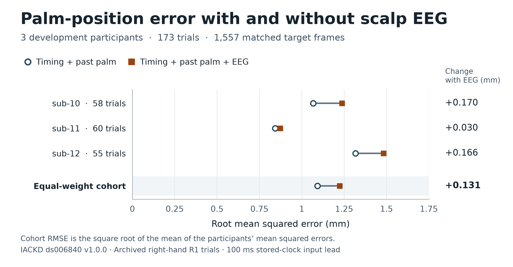

# Does scalp EEG improve a short-horizon palm estimate?

Once you know where a hand was and how fast it was moving, how much does scalp EEG add? In this six-person recording study, adding three scalp channels made the estimate worse for each of the three development participants. We trained on three different people. The model estimated the horizontal position of the right palm on the archived recording clock, 100 ms after the latest input from either instrument.

## What happened

All 337 released trials qualified for the post-observation comparison. The three development participants contributed 173 trials and 1,557 scored positions. Every method used those same positions, and every person contributed equally to the main score.

| Development method | RMSE (mm) |
| --- | ---: |
| Elapsed time + past palm position and velocity | 1.093 |
| Elapsed time + past palm position and velocity + scalp EEG | 1.223 |
| Same EEG model with EEG from the next trial | 1.203 |
| Extrapolate the recent palm velocity | 1.150 |
| Hold the last palm position | 4.439 |
| TRAIN mean palm position | 21.568 |
| Elapsed-time template | 21.575 |
| Elapsed time + scalp EEG | 21.830 |
| Same elapsed-time EEG model with EEG from the next trial | 21.125 |

The primary increase was **0.131 mm**. The three individual increases were 0.170, 0.030 and 0.166 mm. Adding EEG lowered squared error on 72 of the 173 development trials, including 31 of 58 for sub-10. Larger errors on other trials pulled each person's overall RMSE up. Leaving out one development person at a time gave increases from 0.109 to 0.167 mm. Velocity extrapolation had slightly lower mean absolute error than the time-and-palm fit (0.667 vs 0.706 mm) and higher RMSE. [Per-person, per-offset and trial-level error summaries](RESULT.json)



Each row uses the same matched samples for both models. The cohort value is the square root of the mean of the three participants' mean squared errors. [Source results](RESULT.json)

## Where the clock starts

The first frozen window was tied to cue disappearance, event 14. To estimate position at its first target, +100 ms after the native cue row, the model needed palm observations from the native cue row and 50 ms before it. Every released trial lacked at least one required palm observation in that window. The joint support rule excluded all 337 trials, leaving no fitted model or score. [Original protocol](original-cue-window/DESIGN.json) · [Recorded no-fit](original-cue-window/RESULT.json)

The one alternate was specified before any scalp-to-palm fit. It starts each trial at the first finite stored optical position at or after the native cue row. The first available palm observation fell 0–16 ms after nominal cue time across all six recordings and 0–9 ms in development. The nine targets run from +200 to +600 ms after that first observation in 50 ms steps. The oldest EEG and palm inputs for the first target come 10 and 50 ms after the first observation, respectively. The stored target times span 200–616 ms after the cue across all six recordings. The frozen feature description carries over a sentence allowing pre-anchor palm rows from the original window. The alternate's explicit clock and lag rule gives the post-anchor rows above. [Frozen alternate and exact input rules](DESIGN.json)

The optical tracker estimates the centre of a real palm. The released archive aligns and smooths that movement trace and includes EEG processing that can use later values. The first finite value marks where the released position stream becomes available for this analysis. Cue disappearance, first available position and physical movement onset are distinct events. The 100 ms interval is exact in the arrays we scored. Its physical or live acquisition latency remains unverified. [IACKD data descriptor](https://doi.org/10.1038/s41597-026-07146-x) · [Author methods and code](https://github.com/Boketto1/IACKD/tree/c0b595de7571c7e04abae7477c61d0b92b5702cd)

## What each model sees

The elapsed-time template knows which of nine scheduled offsets is being estimated. The past-palm model adds the optical position 100 ms before that target and the backwards velocity computed from it and the point 150 ms before target. The combined model adds two five-sample means at each of C3, Cz and C4. The last EEG sample is also 100 ms earlier than the target. In the rotated comparison, only EEG moves to the next eligible trial within the same person. The timing and past palm stay paired to the original trial. Rotation can change trial condition.

The ridge fits use three TRAIN recordings, an unpenalized intercept at each time offset and a fixed penalty of 0.01 for standardized input coefficients. No development target estimates a coefficient, feature scale or penalty. The released right-hand files lack embedded channel labels. The same-run source headers and channels tables identify C3, Cz and C4, and the documented export order and consistent derivative width support the correspondence. Some released epoch counts differ from the raw event tables. This comparison uses the author's paired derivative epochs. [Input versions, metadata and channel evidence](SOURCE.json) · [Fitted model state](MODEL-STATE.json)

These three development recordings give no evidence of lower error from the particular EEG amplitude features in this fixed offline comparison. The archive contains a constrained screen-feedback task and can carry cue, motion, eye and muscle effects. The original dataset recruited 15 healthy right-handed university students aged 23–27, 11 of them men. This study uses one right-hand run from each of six participants. The result leaves generalization to other people, other tasks, other EEG features, biological mechanisms and live decoding open. [Participant and task description](https://doi.org/10.1038/s41597-026-07146-x)

## Replay a recorded trial

Get one of the six right-hand R1 MAT files from its versioned URL in the source table or run the fetch command below. Extract the converter ZIP and keep its `metadata/` folder and `source-lock.json` alongside the script. From the extracted `public-converter` directory, convert the first released trial for sub-10.

```sh
python -m pip install -r requirements.txt
python mat_to_companion.py --mat ../iackd-data/sub-10_task-ihc_run-01_eeg_leap_R1.mat --trial 1 --output sub-10-trial-01.json
```

Adjust the MAT path to your data folder. On Windows, use `py` if that is how you start Python. The converter checks the input file's name, size and SHA-256. It keeps the full stored trial and its missing optical observations. The ZIP supplies the converter and source metadata. The recording comes from OpenNeuro. [Download the converter](NeuroTranslation-IACKD-R1-Converter.zip) · [Versioned source files](SOURCE.json)

In **Palm replay**, click **Import a trial**, choose your JSON and confirm the import. Select the recording and click **Compare estimates**. The browser plots the tracked palm beside the estimates from both fitted models. **Read sample values** gives the time and position values behind each mark. **Download trial results** saves those estimates locally, along with the model identity. A single recording gives its own matched error. The cohort result above combines the three development participants. Keep the recording JSON and trial export local. [Open Palm replay](https://eliminatenoise.github.io/NeuroTranslation/index.html#palm-replay)

## Reproduce the comparison

Use Python 3.13 in a virtual environment on Windows, macOS or Linux. Install the pinned dependencies and work from this directory. The verification here ran on Linux. The download command asks OpenNeuro's public storage for six versioned files, then checks the returned version, byte count and SHA-256. Keep the source files in a local data folder.

```sh
python -m pip install -r requirements.txt
python fetch_inputs.py --output ../iackd-data
python -m unittest -v
python run.py --input ../iackd-data --output ../availability-run
python original-cue-window/run.py --input ../iackd-data --output ../original-cue-run
```

Choose new output directory names each time. The cue window writes its no-fit result and exits with status 2. The post-observation comparison writes `RESULT.json`, the TRAIN-fitted `MODEL-STATE.json` and local runtime details. A separately implemented analysis matched the original eligibility decision and checked 2,454 numeric values from the alternate fits and results. This bundle includes aggregate errors and model coefficients. The source dataset remains at its original host. [Independent comparison](INDEPENDENT-CHECK.json) · [OpenNeuro ds006840 v1.0.0, CC0](https://doi.org/10.18112/openneuro.ds006840.v1.0.0)

To redraw the comparison from the same aggregate results, run the figure script from this directory.

```sh
python -m pip install matplotlib==3.11.2
python plot_results.py --input RESULT.json --output cohort-comparison.png
```
