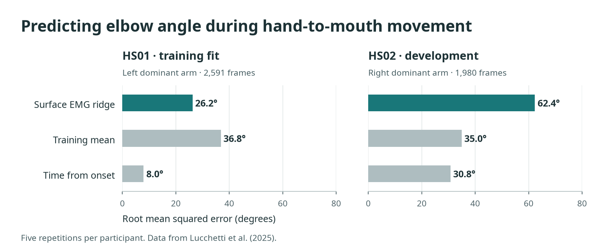

[The studies](../README.md) › Study 5 · Hand to mouth: one person's muscle signal, another's elbow

# One person's muscle signal could not follow another person's elbow

Two people each brought a hand to the mouth five times while electrodes on the skin recorded the arm's muscles and cameras followed markers on the arm. A straight-line fit on the first person's EMG was asked to follow the second person's elbow angle 40 ms ahead. It missed by **62.36°**. The first person's average elbow path, started at the moment the second person's movement started, missed by **30.77°**. The EMG fit lost in all five repetitions.

Those two scores are the measure that punishes large misses (root mean squared error). On the plain average miss (mean absolute error) the result is the same: 58.24° for the EMG fit, 26.37° for the timed average path and 25.10° for a single fixed angle, the first person's average. EMG is electrical activity of muscle, picked up on the skin: a recording of muscle, not of nerve. A *straight-line fit* is a weighted sum of its inputs, here a ridge regression.

| Recording | Frames scored | EMG fit: average miss / large misses | One fixed angle: average miss / large misses | Average path from the start of movement: average miss / large misses |
| --- | ---: | ---: | ---: | ---: |
| HS01, left dominant arm: the person the fit was made on | 2,591 | 21.41° / 26.24° | 34.72° / 36.82° | 4.51° / 7.96° |
| HS02, right dominant arm: the test person | 1,980 | 58.24° / 62.36° | 25.10° / 34.95° | 26.37° / 30.77° |

The person and the arm changed together, left arm to fit and right arm to test, so the study cannot say which of the two broke the fit. The two simple forecasts answer different questions. The fixed angle uses nothing from the test recording. The average path is told when the test movement starts and uses the time since then to look up an angle learned from HS01; it is not stretched or adjusted to fit HS02.



## What went into each forecast

Both files come from the upper-limb dataset of Lucchetti and colleagues. All five marked hand-to-mouth movements in each file were used. The inputs are twelve channels of raw surface EMG in millivolts. The target is the authors' elbow flexion angle, stored as `ElbowFlx` in degrees with the source's sign and joint axes. The authors first smoothed the camera marker paths with a 10 Hz filter run in both directions and filled short gaps with splines, then worked out the joint angle from the result. [Dataset paper and methods](https://doi.org/10.1038/s41597-025-06174-3)

For each angle frame at time *t*, the root mean square voltage of each muscle channel is taken over *t* − 90 ms to *t* − 40 ms inclusive: a short stretch of alternating voltage turned into one amplitude per channel. The fit learns how to weight those amplitudes, with a fixed penalty of 0.01 on mean squared error that keeps the weights small. The scaling, weights and intercept all come from HS01. The average path averages the usable HS01 angles at each frame since the start of movement, fills gaps inside its range by interpolation and holds the nearest end value outside it; no HS02 frame needed that end rule.

The paper describes recording that was synchronised at 1,000 Hz for EMG and 125 Hz for the cameras. The analysis assumes that each stored task starts both clocks together and maps each angle frame to its EMG sample at the 8:1 ratio. The HS01 and HS02 arrays differ from an exact 8:1 ratio by +28 and −69 EMG samples. All the selected movements fit inside both arrays. So the 40 ms lead is a mapping between stored samples: the physical offset, drift and recording delay, and when the processed angle would be available live, were not measured.

The archive's camera-based movement events decide which frames are scored, and the fit receives only EMG amplitudes for those frames. Of 2,651 HS01 frames and 2,040 HS02 frames, 60 in each file lacked enough history within the movement. No target values were missing in the selected movements. The scores above weight every frame equally. [RESULT.json](RESULT.json) also gives the counts, the errors repetition by repetition and their averages.

## What it does not show

Five repetitions from one test person cannot speak for anyone else. A third person, HS03, was set aside and that recording was never opened.

## The plan

The plan, fixed before scoring, is [DESIGN.json](DESIGN.json); the recording IDs, who was used for what and the checksums are in [ASSETS.json](ASSETS.json). It tests no pass threshold: this two-person trial was a first look. The runner's output uses its own labels, **train reference** and **development**, for the fitting and test recordings, and reports CPU affinity on systems that expose it. The original run and the released runner do the same arithmetic.

## Run it yourself

Download the two original version-1 `.mat` files from Figshare and keep their file names. The authors share them under CC BY 4.0. This folder uses them unchanged and publishes only code and summary results. [HS01](https://doi.org/10.6084/m9.figshare.28596026.v1) · [HS02](https://doi.org/10.6084/m9.figshare.28596038.v1) · [CC BY 4.0](https://creativecommons.org/licenses/by/4.0/)

From this folder, put `HS01.mat` and `HS02.mat` in a folder called `data`. Use Python 3.14, as in the recorded Linux run.

**macOS or Linux**

```sh
python3.14 -m venv .venv
.venv/bin/python -m pip install -r requirements.txt
OPENBLAS_NUM_THREADS=1 OMP_NUM_THREADS=1 .venv/bin/python run.py --hs01 data/HS01.mat --hs02 data/HS02.mat --output reproduced.json
```

**Windows PowerShell**

```powershell
py -3.14 -m venv .venv
.venv\Scripts\python.exe -m pip install -r requirements.txt
$env:OPENBLAS_NUM_THREADS = "1"
$env:OMP_NUM_THREADS = "1"
.venv\Scripts\python.exe run.py --hs01 data/HS01.mat --hs02 data/HS02.mat --output reproduced.json
```

The runner checks each file's hash before reading it and writes the scores and run details as JSON. Choose a new output file name for each run. `python -m unittest -v test_baseline` runs the checks on invented data, without the recordings. The run was checked on Linux; the Windows and macOS commands use the same program and have not been run on those systems.

To redraw the figure from the summary results, install Matplotlib and run `python plot_baseline.py RESULT.json elbow-angle-error.png`.

Every author of the dataset and of the two records, with the credit owed: [docs/RIGHTS.md](../../docs/RIGHTS.md).
