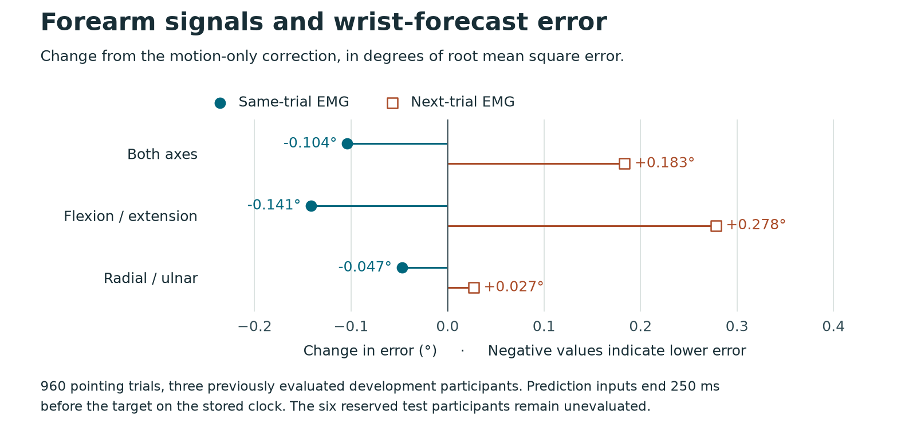

# Can the forearm improve a forecast of wrist motion?

A wrist encoder tells us how the wrist has moved. A forearm electrode picks up electrical activity at the skin. We asked whether the forearm signal still helped once a model had learned the wrist’s recent path and knew how long it had been since the cue.

We kept the three [trained motion models](../wrist-pointing-temporal/) fixed. Their mean forecast had a two-axis error of **4.053°**. A new output layer learned to correct that forecast from the motion models’ internal activity, the last two measured angles and the cue time. That brought error to **3.957°**. Giving the correction four pairs of surface electromyography (EMG) signals brought it to **3.853°**. All three forecasts targeted the same wrist angles, 250 ms ahead on the stored clock.

| Forecast | Two-axis RMSE | Flexion / extension | Radial / ulnar deviation |
| --- | ---: | ---: | ---: |
| Frozen motion models | 4.053° | 5.098° | 2.622° |
| Motion-only correction | 3.957° | 4.947° | 2.615° |
| Motion + same-trial EMG | 3.853° | 4.806° | 2.568° |
| Motion + next-trial EMG | 4.140° | 5.225° | 2.642° |

The last row keeps the fitted weights, earlier wrist angles and target time fixed. Only the forearm signal changes. It comes from the next pointing trial in the same person and block, at the same time after the cue. The shift raised error by **0.287°** compared with the correctly paired EMG. Surface electrodes can also pick up nearby muscles, movement and contact changes. This comparison establishes what the paired recording added to the forecast in this task.

Six people supplied 1,879 eligible training trials. The corrections were fitted and frozen before scoring this comparison. Three other people, previously evaluated in the wrist studies, supplied 960 development trials and 5,760 two-axis targets. Each person contributes equally to the reported root mean square error (RMSE). Both axes improved in each of those three people. Six reserved participants remain unevaluated. The source reports 100 Hz encoder updates, so the 250 ms interval on the 512 Hz recording grid leaves the physical device delay unresolved.

## Run a forecast

[Open the forearm forecast in your browser](https://eliminatenoise.github.io/NeuroTranslation/wrist-forearm/) or [download the offline browser and launchers](WristMotion-Forearm-Browser.zip). Choose an invented example to see the three forecasts, or open an original unmodified development ZIP from [the deposit](https://doi.org/10.6084/m9.figshare.29666735.v3) and select its block and trial. For a real recording, **Forecast error** shows the predicted angle minus the measured angle at each target time. Files are read locally in a background worker.

- [Download the recorded-trial runner](WristMotion-Forearm-Recorded-Trial.zip). Extract the whole folder and follow its README to forecast one movement from an original development ZIP. Each printed row pairs the measured angle with the frozen forecast and the two learned corrections.
- [Download the fitted models and synthetic examples](WristMotion-Forearm-Correction.zip). The twelve invented windows run with Python’s standard library. The archive also contains both learned matrices, the three frozen motion models, the fitting code and the study design.
- [Read the aggregate scores](DEVELOPMENT-AGGREGATE.json) or [reproduce the figure](plot_wrist_transfer.py). The [earlier wrist replay](https://eliminatenoise.github.io/NeuroTranslation/wrist-replay/) lets you explore the original temporal forecasts in your browser.

## Source

Jorge German Perez Blanco and Javier Mauricio Anteliz Ortiz deposited *EEG-EMG-WristMotion Dataset*, version 3, under CC BY 4.0. NeuroTranslation derived the earlier wrist and differential forearm features, fitted the corrections and produced the figure from aggregate errors. [Dataset](https://doi.org/10.6084/m9.figshare.29666735.v3) · [Study descriptor](https://doi.org/10.1038/s41597-026-07287-z) · [Licence](https://creativecommons.org/licenses/by/4.0/)

The browser model and archive checker can be rebuilt from the two published ZIPs with the Python standard library. From this study directory, run `python browser-source/build_browser.py rebuilt` and compare the hashes it prints with [the recorded source and asset hashes](SOURCE.json). The study software reads the original ZIP locally, verifies its fingerprint, then reads the selected block and trial. The released recording is separate from the browser download.
