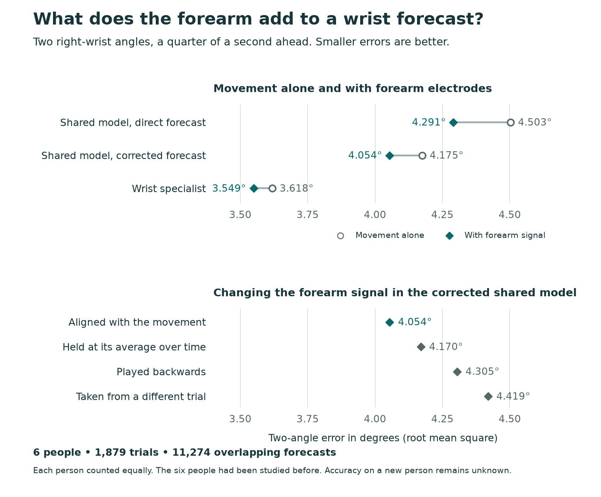

# NeuroTranslate 0.0

The current checkpoint also forecasts both knees 15 frames ahead from four seconds of walking. [Run the knee example](neurotranslate-0.0/knee/) · [Compare forecasts](https://eliminatenoise.github.io/NeuroTranslation/knee-stride/)

The same checkpoint forecasts tracked movement distance in centimetres, two right-wrist angles in degrees and displacement on a rat’s W-shaped track. Give it five earlier tracking points and, optionally, a second of firing counts from two brain regions. The movement encoder first reads the changes in position. A separate fitted calculation pairs the firing in each interval with the movement state from that interval. [Download the CPU model](neurotranslate-0.0.zip) · [Input examples and methods](neurotranslate-0.0/)

The movement viewer compares right-wrist angles with different combinations of movement, forearm and scalp input, and still runs the two original distance forecasts. The cross-animal track viewer lets you choose the direct linear benchmark or the shared movement encoder at the same forecast cutoff. [Wrist and distance viewer](https://eliminatenoise.github.io/NeuroTranslation/shared-motion/) · [Track recording and both model families](https://eliminatenoise.github.io/NeuroTranslation/population-motion/)

[Download the browser predictor](movement-browser.zip) · [Rebuild the browser model and trace viewer](browser-source/)

### What did firing add to the shared model?

On the same 549 forecast instants compared in the linear benchmark, the shared movement model had an average error of **2.805 cm** with movement alone and **2.778 cm** with correctly timed CA1 and prefrontal firing. Substituting firing from an earlier trip gave **2.804 cm**. Only one of three rats improved over both controls. A comparison with scrambled movement-encoder weights scored **2.763 cm** with firing. These results establish that the fitted readout uses the firing signal. They give no evidence here that pretraining improved this forecast. A lower average error can hide a worse result in an individual animal. [Study and per-animal results](neurotranslate-0.0/population/)

## Force underfoot

Two plates in a walkway measure the load where a foot lands on them. Six fitted models use recent marker positions, right-leg muscle activity, or both to estimate their combined reading 100 ms later on the recording clock. Across eight test walkers, adding muscle activity to the marker Transformer raised the average absolute error from 65.19 to 70.20 N. A separate task fits the shared model to the reading on the plate assigned to the right foot after heel strike. [Compare the six models](https://eliminatenoise.github.io/NeuroTranslation/walking-force/) · [Two-plate model and results](walking-force/) · [Shared right-foot model](neurotranslate-0.0/right-plate/) · [Read the paper](https://eliminatenoise.github.io/NeuroTranslation/papers/muscle-and-floor/)

## Predicting finger movement in a different person

The five people had different recording layouts. We grouped contacts by the brain area named in the source, recorded which areas were missing, then trained on four people at a time. A model based on the cue and its timing still had the smallest average error in the fifth person. [Test the model](https://eliminatenoise.github.io/NeuroTranslation/finger-transfer/) · [Calibrations, fitted weights and results](finger-transfer/)

## Predicting a knee's turning moment

The shared checkpoint now takes six sagittal joint angles to estimate both knee moments in N·m/kg. On three test walkers, the task-trained model gave 0.08874 average error, the linear fit 0.09761 and motion matching 0.09373. Their ranking varied by person. [Run the model](https://eliminatenoise.github.io/NeuroTranslation/knee-moment/) · [Angle-only and earlier-moment comparisons](neurotranslate-0.0/load/)

## Predicting the five glove sensors

How much will each finger move when the screen names one of them? In a single recording, the cue alone gave lower errors than a model that also received cortical activity. The target was the average size of the changes between four future glove readings. [Study and saved models](finger-motion/) · [Try the browser model](https://eliminatenoise.github.io/NeuroTranslation/finger-motion/) · [Complete offline download](finger-motion.zip)

A glove recorded how far each finger bent in the device’s own units. Recent glove readings and the word on the screen forecast readings three glove samples ahead. Keeping the last reading gave the lowest average error. Adding a recording from the surface of the brain worsened both fitted forecasts in this one-person experiment. [Study, source and fitted models](cortical-glove/) · [Try the offline-capable reader](https://eliminatenoise.github.io/NeuroTranslation/finger-signals/)

## Compare the same four seconds of knee movement

An earlier stride supplies the starting answer. A correction trained specifically for the knees averaged 2.679° of error, against 3.535° for stride replay. The new knee output on the shared movement model gave 3.465°. Both evaluations used the same 12 previously studied walkers. In ten walkers measured with optical markers in a second laboratory, the unchanged task-trained model averaged 3.242°, replay 3.398° and the linear correction 3.602°. The advantage over replay was uncertain. [External test](knee-stride/external-optical/) [Task-trained model](knee-stride/) · [Download the standalone predictor](knee-stride-model.zip) · [Offline reader](knee-stride.zip) · [Reader source](knee-stride-source.zip)

## Do the muscles and knees repeat at the same rate?

For 11 held-out walkers at 0.5 m/s, the strongest rhythms in the leg-muscle recordings and knee angles differed by 0.027 cycles per minute on average. Pairing each walk with another walker’s muscle recording raised the difference to 3.055. Each instrument supplied its own 40-second window. Agreement in rate leaves the timing of individual steps unresolved. The peaks landed on the same search frequency for nine people and one 0.15-cycle-per-minute grid interval apart for two. A 40-second window has a natural frequency spacing of about 1.5 cycles per minute. These comparisons measure agreement between estimates made with the same method.

[Compare the rhythms](https://eliminatenoise.github.io/NeuroTranslation/gait-rhythm/) · [Study and results](gait-rhythm/) · [Offline reader and source (ZIP)](gait-rhythm.zip) · [Read the supplement](https://eliminatenoise.github.io/NeuroTranslation/papers/walking-rhythm/)

## Where will the knees be 15 stored frames later?

Five snapshots of both hips, knees and ankles predict the two knee angles 15 frames later in a stored 60 Hz treadmill recording. On 40,201 forecasts from 12 held-out walkers, replaying a stride from four seconds of knee history gave 3.54° mean absolute error. The transformer, with 0.4 seconds of joint history, gave 4.46° on the same windows. At the same five input times, the transformer averaged 4.47° across all 42,781 eligible windows and a six-joint linear fit averaged 5.60°. Each walker counts equally.

Six of the 51 recordings used whole-file Xsens HD processing, including test recording S48. The other 45 carry the Live label. Physical prediction latency was never measured. Only reconstructed joint angles entered the forecast. The brain and muscle recordings from the source study belong to separate measurements.

[Try the knee forecast](https://eliminatenoise.github.io/NeuroTranslation/knee-motion/) · [Model and results](knee-motion/) · [Offline viewer and model (ZIP)](knee-motion.zip)

## Where will the next step land?

Give the model half a second of a measured walk or run. It predicts the next 0.60 seconds at 18 points on the body. Turn the figure, follow one foot and reveal where its markers landed. The walk or run label reduced average error at points measured relative to the pelvis from 71.9 to 69.1 mm across six fresh recording groups. A linear forecast tracked the pelvis through the room more closely. Only one of the six groups ran.

[Continue a measured stride](https://eliminatenoise.github.io/NeuroTranslation/stride/) · [Model and results](stride-continuation/) · [Offline viewer and model (ZIP)](stride-continuation.zip)

## Can brain activity sharpen a rat’s movement forecast?

Step through one recorded trip and compare how far a rat moved with forecasts that use its earlier movement alone or also use firing from two brain regions. Across three held-out rats the average miss fell from 2.898 to 2.870 cm when firing was added. Only one rat improved against both movement alone and firing from an earlier trip. For that rat, continuing at the last observed speed did better still.

[Explore a recorded trip](https://eliminatenoise.github.io/NeuroTranslation/population-motion/) · [Model and results](population-motion/) · [Offline viewer and model (ZIP)](population-motion.zip)

## Generate a walk or a run

Enter **walk** or **run**. A small network fitted to 31 motion-capture recordings generates the positions of 18 surface landmarks over 0.60 seconds. The viewer can overlay those points on a measured training example. Two walks and a run qualified for the held-out comparison. The model’s average error relative to the pelvis was 89.82 mm. Using the training average for each action gave 89.88 mm.

[Try the two commands](https://eliminatenoise.github.io/NeuroTranslation/word-motion/) · [Python and JavaScript inference, weights and study](word-motion/) · [Offline viewer and model (ZIP)](word-motion.zip)

## Which wrist forecast should I run?

Both downloads below forecast how far the right wrist will bend back and tilt towards the thumb a quarter-second later. Each accepts recent wrist motion and optional measurements of electrical activity at the forearm. Both run locally with Python and NumPy.

| Download | What it does | Two-angle error with forearm input |
| --- | --- | --- |
| [Shared Transformer](neurotranslate-0.0.zip) | Keeps the two distance tasks and all three earlier angle modes. For wrist angles, you can now add a learned correction to its motion forecast. | 4.054° |
| [Wrist specialist](wrist-specialist.zip) | Uses a network fitted specifically to wrist movements. It reports the motion forecast, the amount added or subtracted from each angle and the final prediction. | 3.549° |

We compared methods on 1,879 trials from six previously studied people. Each person took a turn as the test person. The shared model’s correction trained on movement alone had an error of 4.175°. Adding forearm activity lowered it to 4.054°, with improvement in four of six people. Using another trial’s forearm recording raised error to 4.419°. Both downloads contain final weights fitted using all six people. Their accuracy on a new participant is unknown. [Shared correction, controls and example](neurotranslate-0.0/forearm/) · [Specialist source and example](wrist-specialist/)

[Download the comparison figure (PDF)](figures/wrist-correction.pdf) · [Recreate it from the published scores](figures/plot_wrist_correction.py)

The wrist models return numerical estimates. In an extreme invented example, the corrected shared model predicted about −1,692° of extension, far beyond the movement of a human wrist. Its output has no anatomical limit. To reproduce both angles, pass the invented input to the browser package’s Node.js command. [Boundary input](examples/wrist-angle-range-check.json) · [Command and input format](neurotranslate-browser/README.md)

### Three direct wrist-angle forecasts

In six tests, each leaving one of six training participants out, reading past wrist angles alone produced **4.503°** of two-axis error. Adding forearm measurements lowered it to **4.291°**. With scalp measurements included as well, it was **4.491°**. An earlier movement-and-forearm correction model reached **3.549°** on the same observations. A matched control with randomly initialized frozen temporal layers also performed at least as well in all three input conditions. The comparison supports running the added angle path but did not establish a predictive benefit from the pretrained core on this task. The fitter and source-data recipe preserve separate angle and distance units. [Angular study and methods](neurotranslate-0.0/README.md)

## A shared model for two tracking tasks

A headset tracks a wrist in three dimensions. A camera tracks a rat in two dimensions. Both can measure how far the point moved between observations. Give this model five earlier positions in the same coordinate system, or the four intervals calculated from those positions. It predicts the straight-line distance to the next position about a quarter-second later, in centimetres.

**[Run the shared model in a browser](https://eliminatenoise.github.io/NeuroTranslation/shared-motion/).** Compare an actual rat training trip with an invented wrist history or enter your own earlier tracking samples. The model runs on your device. You can save the self-contained page for offline use.

The two tasks use **one fitted Transformer checkpoint**. The same attention layers learn from both kinds of movement. A small final readout for each task turns the shared representation into a distance. The result gives a magnitude. The positions along a path and its direction require other predictions. [Download the model and source (ZIP)](shared-motion-distance.zip) · [Usage and reproduction](shared-motion/README.md)

The original two-domain browser module remains available for reproducing the comparison below. It accepts four motion intervals or derives them from time-stamped tracking points. Its two distributed examples are invented. [Browser runtime and API](shared-motion-browser/) · [Download the standalone JavaScript package](shared-motion-browser.zip)

## Did learning together help?

| Quarter-second forecast | Human wrist | Rat position |
| --- | ---: | ---: |
| Shared Transformer | 1.725 cm | 1.310 cm |
| Single-task Transformer, equal exposure to its own recordings | 1.782 cm | 1.342 cm |
| Single-task Transformer, equal total training updates | 1.759 cm | 1.388 cm |
| Best of the two linear baselines | 1.922 cm | 1.119 cm |

Each entry is mean absolute error. Smaller is better. Each of six acquisition groups for the human wrist and each of nine held-out trips for the rat had equal weight within its task. The comparison used 583 wrist windows and 106 rat windows. Both evaluation collections had been examined in earlier work, and all the rat trips came from one animal. Windows from the same group or trip can contain related movements.

The shared model’s average errors were slightly lower than those of the separately trained attention models. On both tasks the uncertainty interval for the equal-exposure comparison included zero. The linear baseline also beat the shared model on the rat recordings. Neither task passed the full decision rule for a transfer benefit. The weights demonstrate joint learning on these two collections. Additional people, animals and movements remain to be tested. [Frozen protocol and complete results](shared-motion/shared-motion-model/README.md)

[Download the figure as a PDF](figures/transfer-comparison.pdf) · [Figure source](figures/plot_transfer.py)
