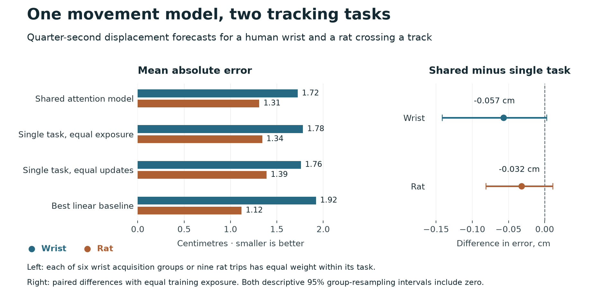

# One movement model for two tracking tasks

A headset tracks a wrist in three dimensions. A camera tracks a rat in two dimensions. Both can measure how far the point moved between observations. Give this model five earlier positions in the same coordinate system, or the four intervals calculated from those positions. It predicts the straight-line distance to the next position about a quarter-second later, in centimetres.

The two tasks use **one fitted Transformer checkpoint**. The same attention layers learn from both kinds of movement. A small final readout for each task turns the shared representation into a distance. The result gives a magnitude. The positions along a path and its direction require other predictions. [Download the model and source (ZIP)](shared-motion-distance.zip) · [Usage and reproduction](shared-motion/README.md)

The same fitted weights also run directly in a browser. The JavaScript API accepts the four motion intervals or derives them from time-stamped tracking points. It uses one model file for both tasks, and both distributed examples are invented. [Browser runtime and API](shared-motion-browser/) · [Download the standalone JavaScript package](shared-motion-browser.zip)

## Did learning together help?

| Quarter-second forecast | Human wrist | Rat position |
| --- | ---: | ---: |
| Shared Transformer | 1.725 cm | 1.310 cm |
| Single-task Transformer, equal exposure to its own recordings | 1.782 cm | 1.342 cm |
| Single-task Transformer, equal total training updates | 1.759 cm | 1.388 cm |
| Best of the two linear baselines | 1.922 cm | 1.119 cm |

Each entry is mean absolute error. Smaller is better. Each of six acquisition groups for the human wrist and each of nine held-out trips for the rat had equal weight within its task. The comparison used 583 wrist windows and 106 rat windows. Windows from the same group or trip can contain related movements.

The shared model’s average errors were slightly lower than those of the separately trained attention models. On both tasks the uncertainty interval for the equal-exposure comparison included zero. The linear baseline also beat the shared model on the rat recordings. Neither task passed the full decision rule for a transfer benefit. The weights demonstrate joint learning on these two collections. Additional people, animals and movements remain to be tested. [Frozen protocol and complete results](shared-motion/shared-motion-model/README.md)

[Download the figure as a PDF](figures/transfer-comparison.pdf) · [Figure source](figures/plot_transfer.py)
