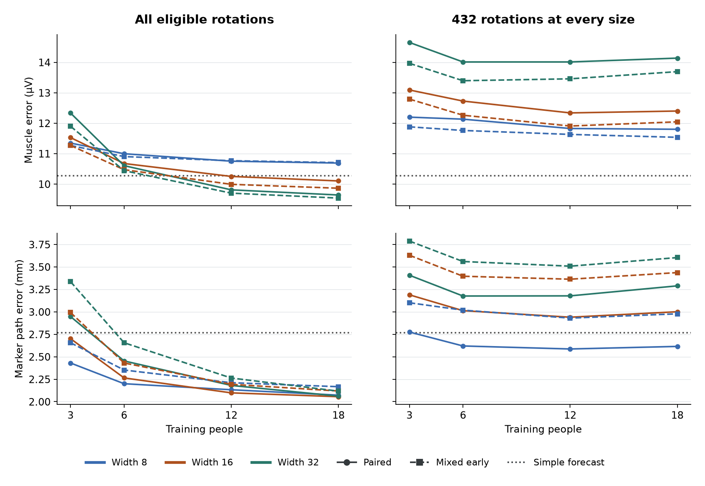

# Can three people tell us which model will win at eighteen?

A small balance experiment picked the narrowest networks. A larger experiment on the same task picked wider ones. For muscle voltage, 12 of 15 pairwise model rankings reversed between three and eighteen training people. For marker movement, seven reversed. Yet if we held the number of training examples at 432, **the rankings at three and eighteen people agreed on all 15 pairs for both outcomes**. How the study grew changed what the small experiment predicted. [Numerical comparisons](results.json)

Steven Peterson and Daniel Ferris recorded people standing or walking on a balance beam while the visual scene tilted. Here, each model saw 625 milliseconds of scalp voltage, lower-leg muscle voltage and motion of a marker at the base of the spine. It predicted the next 125 milliseconds of muscle activity and marker movement. We compared every forecast against the same 1,759 recorded rotations in six people excluded from training. This group had already been studied. Six other people remained in reserve. [Original recordings, CC0](https://openneuro.org/datasets/ds003739/versions/1.0.3) · [Acquisition methods](https://www.sciencedirect.com/science/article/pii/S2352340921009100)



Each point gives equal weight to the six assessment people. The left column adds people and all their rotations. The right fixes the budget at 432 rotations, split equally across people, postures and tilt directions. The dotted line repeats the previous muscle-voltage amplitude and continues the marker along its recent velocity. Uncertainty and individual results are available for every point. [Participant summaries and training-seed results](person-scores.json)

## What survived the increase in scale?

The six complete networks differed in two ways. A paired network first combined scalp and muscle voltages in one branch, and marker positions and a constant-velocity projection in the other. Its rival mixed all four inputs before forming branches. Each design came in widths of 8, 16 and 32, referring to the number of learned values each sensor projection produced. The three sizes had 2,364, 6,244 and 18,612 trainable parameters. The projection of marker velocity came from the same camera measurements.

| Training people | Distinct training rotations | Lowest muscle error among six | Lowest marker path error among six | Pairs reversed against 18, muscle / path |
|---:|---:|---|---|---:|
| 3 | 877–878 | Early mixing, width 8 · 11.267 µV | Paired, width 8 · 2.430 mm | 12 / 7 |
| 6 | 1,712–1,742 | Early mixing, width 32 · 10.440 µV | Paired, width 8 · 2.200 mm | 2 / 7 |
| 12 | 3,426–3,453 | Early mixing, width 32 · 9.702 µV | Paired, width 16 · 2.098 mm | 0 / 3 |
| 18 | 5,179 | Early mixing, width 32 · 9.539 µV | Paired, width 16 · 2.055 mm | reference |

Three prespecified training-person orders show how much depends on who turns up first. For muscle voltage, a three-person order reversed 11, 11 or 12 pairs against eighteen. At twelve, every order picked the same muscle winner as eighteen. For marker movement, two of three twelve-person orders picked the eventual winner. In a walking-only breakdown, the path leader changed from paired width 16 at twelve people (3.287 mm) to paired width 32 at eighteen (3.221 mm), even as the two-posture leader stayed the same. Some ranks depended on differences far below a tenth of a millimetre. At eighteen, the width-16 paired model led its width-32 counterpart by 0.006 mm. Their paired difference had a descriptive 95% participant interval from −0.068 to +0.038 mm. At three, the muscle-error gap between the two leading early-mixing widths was 0.001 µV, with an interval from −0.070 to +0.063 µV. [Rankings by training group and average errors](results.json)

## Another person or another recording?

Take the width-16 paired model. Holding the total at 432 rotations, spreading them across eighteen people instead of three reduced muscle error by 0.692 µV (95% interval 0.309–1.023) and marker path error by 0.188 mm (0.116–0.262). Five of six people improved on muscle voltage and all six improved on movement. The improvements were uneven along the way. With twelve training people, its average errors at this fixed budget were 12.337 µV and 2.940 mm. With eighteen they were 12.398 µV and 3.001 mm.

Now keep the same eighteen people and give the model more of their recorded rotations. Moving from 432 to 5,179 reduced muscle error by 2.296 µV (1.642–2.979) and movement error by 0.946 mm (0.783–1.109). All six improved on both. The muscle winner changed from width 8 at 432 examples to width 16 at 864 and width 32 at 1,728. The movement winner changed from width 8 at 1,728 to width 16 at 3,456. The size of the training pool changed while every network received the same 49,152 sampled examples, drawn with replacement over 384 updates. At full size the three training seeds drew 5,179, 5,178 and 5,179 distinct events. The final all-available pool also restores natural differences in the number of usable rotations per person and condition. Sampling gave each person and condition equal weight throughout. [Fixed-person and fixed-example curves](results.json)

## Which measurements helped?

At eighteen training people, the paired width-16 network scored 10.102 µV and 2.055 mm. Separately training it without the scalp-voltage values, while retaining the channel-availability flags, reduced both errors in every assessment person, to 9.972 µV and 2.024 mm. Removing both scalp and muscle voltages raised muscle error to 13.402 µV. Removing both marker position and its derived velocity projections raised path error to 4.538 mm. Surface electrodes measure electrical activity. Neither nerve firing nor muscle force was measured here. [All modality controls](results.json)

The simple forecast reached 10.274 µV and 2.769 mm overall. During standing, extending the marker’s previous velocity remained more accurate than the width-16 paired network, at 0.674 versus 0.833 mm. During walking, the same network gave 3.278 mm versus 4.864 mm for the velocity rule. Standing preceded walking in the acquisition, so posture, time and fatigue may contribute to this difference. [Measured condition averages](results.json) · [Recording protocol](https://www.sciencedirect.com/science/article/pii/S2352340921009100)

## How far can the curve predict?

We used the three-, six- and twelve-person errors to forecast the eighteen-person result before including that point in the curve fit. Carrying forward the twelve-person result missed by an average of 0.122 µV across the six complete networks. A diminishing-error curve with a nonnegative floor and a term proportional to one over the square root of training people missed by 0.178 µV. On movement the order reversed, with average misses of 0.081 mm and 0.066 mm respectively. The two forecasts were compared on the same historical six assessment people. The largest width-16 results were already known from the preceding study. [Forecasts for every configuration](results.json)

These recordings support a limited use for smaller experiments. By twelve training people, they identified both observed leaders on average. By three, they had already identified the better grouping for each outcome at its best width, but they underpredicted the width those groupings could use. We tested one acquisition protocol, one short horizon and fewer than 19,000 parameters. Estimating an irreducible error floor, a universal exponent or the performance of a much larger transformer would require evidence at additional scales and independent populations.

## Reproduce the results

The upstream paired-study reader fixes the eligible events, participant split and time alignment. It compares three central scalp sites, eight muscle channels and one optical marker. It uses the available scalp sites with explicit presence flags. The archive contains offline-filtered signals, and qualification required valid future measurements. Each model used training-subset statistics only. We preserved the original optimizer, losses, balancing and three training seeds. Muscle error averages absolute amplitude errors over eight channels. Path error averages 32 three-dimensional distances. Reported intervals resample whole assessment people together, conditional on the training sets. They give exploratory uncertainty for six people. [Frozen protocol](protocol.json) · [Pinned paired-study source and preparation instructions](https://github.com/eliminatenoise/NeuroTranslation/tree/f2fb8a1bec811642b6718ec155e1bf755ac4bd0f/models/neural-and-muscle-composites/balance)

Follow the upstream instructions to produce the two private paired archives. Set `BALANCE` to the pinned paired-study code directory and `WORK` to the directory containing your local data. The recorded fit captures process affinity through Linux. From this directory on Linux, run the following in a Python environment with NumPy, SciPy and PyTorch. Matplotlib is used only for the figure. The recorded run used NumPy 2.5.3, SciPy 1.18.1 and PyTorch 2.14.0 on CPU. On a machine with fewer available cores, pass `--workers 1` to `fit`.

```sh
export OPENBLAS_NUM_THREADS=1 OMP_NUM_THREADS=1 MKL_NUM_THREADS=1 PYTHONDONTWRITEBYTECODE=1
python run.py fit --source "$BALANCE" --development "$WORK/paired-development.npz" --private "$WORK/scale-fits"
python run.py score --source "$BALANCE" --assessment "$WORK/paired-assessment.npz" --private "$WORK/scale-fits" --output "$WORK/scale-scores"
python analyze.py "$WORK/scale-scores/person-scores.json" "$WORK/scale-scores/results.json"
python plot.py "$WORK/scale-scores/results.json" "$WORK/scale-scores/training-size.png"
```

The fit command builds every network locally. If you already have the exact upstream private weights, `--reuse "$WORK/refit.npz"` reuses the original full-data width-16 networks after checking their hash and scale factors. The study scored 621 model and dataset combinations including three seeds, with 15 exact reused fits. All fitting and scoring stayed on CPU. Fitting took 37.52 seconds, including process and file overhead, and scoring took 6.15 seconds on this workstation. Private weights and event data remain outside this release. [Resource measurements and scope](runtime.json)
